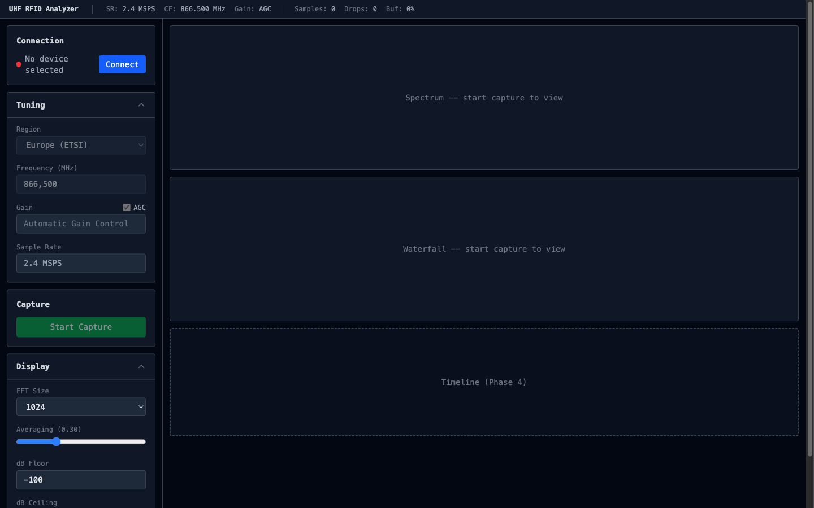
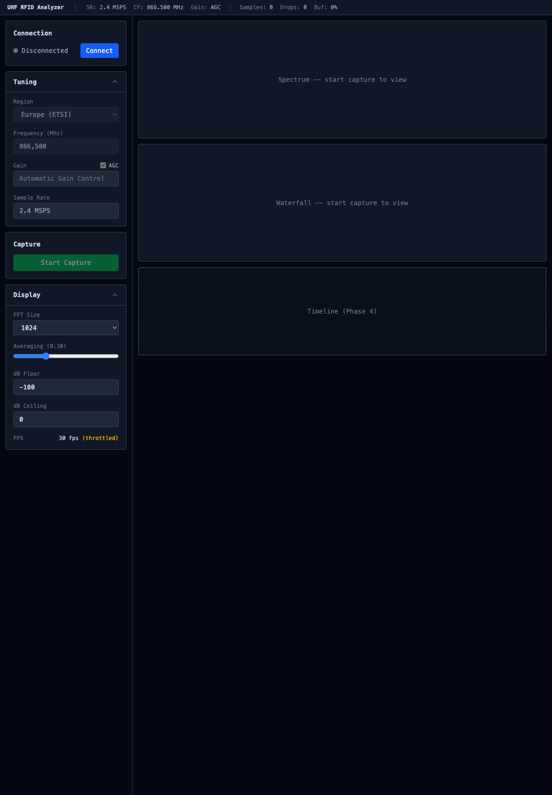

# UHF RFID Analyzer

Browser-based UHF RFID protocol analyzer using RTL-SDR via WebUSB. Connect a cheap RTL-SDR dongle, tune to the UHF RFID band, and see live spectrum, waterfall, and decoded protocol messages — all running in your browser with zero native installs.



## Features

- **WebUSB RTL-SDR** — Connect directly to RTL-SDR hardware from Chrome/Edge, no drivers or native software needed
- **Live Spectrum Display** — Real-time FFT spectrum with peak hold, grid lines, and dBFS axis labels
- **Waterfall Spectrogram** — Scrolling time-frequency heatmap showing RF activity over time
- **UHF RFID Region Presets** — One-click tuning for EU (ETSI 865-868 MHz), US (FCC 902-928 MHz), China, and Japan bands
- **Configurable DSP** — Adjustable FFT size (256-2048), spectrum averaging, dB range, with adaptive framerate
- **Worker-Based Pipeline** — All DSP runs off the main thread via Web Workers and SharedArrayBuffer for smooth UI

## Requirements

- **Browser**: Chrome or Edge (WebUSB support required)
- **Hardware**: RTL-SDR dongle (RTL2832U-based)
- **OS**: macOS, Linux, or Windows with WebUSB-compatible USB drivers

> On Linux you may need udev rules to allow browser access to the RTL-SDR. On Windows, use Zadig to install WinUSB drivers.

## Getting Started

```bash
# Clone
git clone https://github.com/MartBent/rtl-sdr-uhf-rfid-analyzer.git
cd rtl-sdr-uhf-rfid-analyzer

# Install dependencies
npm install

# Start dev server
npm run dev
```

Open http://localhost:5173 in Chrome or Edge.

### Usage

1. Plug in your RTL-SDR dongle
2. Click **Connect** and select the device from the WebUSB picker
3. Select your region (EU, US, China, Japan) or set a custom frequency
4. Click **Start Capture**
5. Watch the spectrum and waterfall display RF activity in real time

## Screenshots

### Application UI



## Architecture

```
RTL-SDR (USB) ──► USB Worker ──► SharedArrayBuffer Ring Buffer ──► DSP Worker ──► Main Thread
                   (WebUSB)        (zero-copy IQ transfer)         (FFT pipeline)   (Canvas 2D)
```

- **USB Worker** — Handles WebUSB device I/O and IQ sample capture
- **DSP Worker** — FFT processing with Blackman-Harris windowing, DC removal, dBFS magnitude, EMA averaging (powered by [webfft](https://github.com/nicedoc/webfft) WASM)
- **Ring Buffer** — Lock-free SharedArrayBuffer for high-throughput IQ data transfer between workers
- **Canvas 2D Renderers** — Spectrum line trace and waterfall spectrogram with adaptive framerate (60/30/15 fps auto-degrade)

## Tech Stack

- [SvelteKit](https://svelte.dev/) (Svelte 5) — UI framework with runes-based reactive state
- [Tailwind CSS](https://tailwindcss.com/) v4 — Styling
- [webfft](https://github.com/nicedoc/webfft) — WASM-powered FFT
- [@jtarrio/webrtlsdr](https://github.com/nicedoc/webrtlsdr) — WebUSB RTL-SDR driver
- [ringbuf.js](https://github.com/nicedoc/ringbuf.js) — Lock-free ring buffer over SharedArrayBuffer
- [Vite](https://vite.dev/) 8 — Build tool with WASM and top-level await support
- [Vitest](https://vitest.dev/) — Testing

## Development

```bash
# Run tests
npm test

# Run tests in watch mode
npm run test:watch

# Build for production
npm run build

# Preview production build
npm run preview
```

## Roadmap

- [x] **Phase 1**: Foundation & Hardware Connection — WebUSB RTL-SDR, worker pipeline, tuning UI
- [x] **Phase 2**: RF Visualization — Live spectrum display and waterfall spectrogram
- [ ] **Phase 3**: Protocol Decoding Engine — PIE demodulation, EPC Gen2 command parsing, CRC validation
- [ ] **Phase 4**: Timeline & Message View — Live decoded message timeline with filtering and timing

## License

ISC
